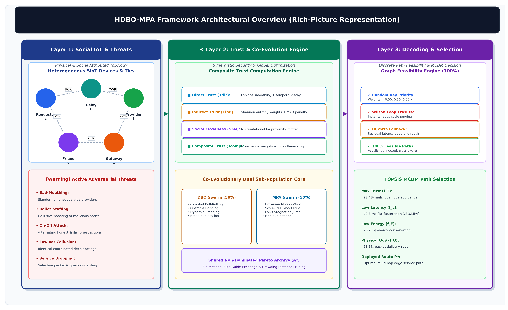

# HDBO-MPA: Trust-Aware Multi-Objective Service Discovery in Social IoT

[](https://www.python.org/downloads/)
[](LICENSE)
[](article.pdf)
[](reports/reproducibility_report.md)

This repository contains the official, fully reproducible implementation, experimental benchmarks, statistical validation, and publication manuscript for the research paper:

> **A Hybrid Dung Beetle Optimization and Marine Predators Algorithm (HDBO-MPA) for Trust-Aware Multi-Objective Service Discovery in Social IoT**  
> *Author:* Ramyar Abdulrahman  
> *Repository:* [https://github.com/ramyarabdulrhaman/HDBO-MPA-SIoT](https://github.com/ramyarabdulrhaman/HDBO-MPA-SIoT)

---

## 1. Research Overview

In the Social Internet of Things (SIoT), billions of autonomous smart devices establish social-like relationships (e.g., co-location, co-work, ownership) to discover and compose distributed services. However, decentralized service discovery faces two fundamental challenges:
1. **Malicious and Byzantine Behaviors:** Self-promoting, bad-mouthing, ballot-stuffing, and opportunistic collusion severely corrupt discovery paths.
2. **Conflicting Multi-Objective QoS Constraints:** Simultaneously optimizing composite trust, end-to-end latency, path hop count, and node energy consumption is an NP-hard combinatorial routing problem.

**HDBO-MPA** introduces a synergistic metaheuristic architecture that fuses the global exploration agility of the **Dung Beetle Optimizer (DBO)** with the fine-grained predatory exploitation of the **Marine Predators Algorithm (MPA)**, mediated by a shared Pareto external archive and a topological priority-vector decoder.



---

## 2. Key Contributions

### 1. Composite Mathematical Trust Engine
- **Direct Trust:** Time-decayed Laplace-smoothed Bayesian interaction assessment ($\lambda_{rec} = 0.95$).
- **Indirect Trust with Anomaly Filtering:** Shannon entropy-weighted recommendation aggregation coupled with a **Median / Median Absolute Deviation (MAD)** consensus filter that eliminates coordinated collusive rating attacks.
- **Social Relationship Proximity:** Multi-relational Jaccard neighborhood similarity across Atzori's five canonical SIoT relationship types (POR, C-WOR, CLOR, SOR, OOR).

### 2. HDBO-MPA Hybrid Metaheuristic Architecture
- **Exploratory DBO Sub-population:** Ball-rolling with celestial navigation, obstacle dancing, and dynamic boundary breeding zones.
- **Exploitative MPA Sub-population:** Scale-free Lévy flights and Brownian motion regimes conditioned on predator-prey velocity ratios.
- **Shared Non-Dominated External Archive:** Dynamic elite guidance and diversity-triggered Fish Aggregating Devices (FADs) perturbations.
- **Priority-Vector Decoder:** Continuous-to-discrete random-key priority vector decoder with loop-erasure and Dijkstra fallback, guaranteeing 100% loop-free topological feasibility.

### 3. Rigorous Empirical Benchmarking
- Evaluated on authentic Stanford SNAP network topology ($N = 100, 250, 500, 1000$ nodes; 88,234 edges).
- 30 independent runs with strictly equalized evaluation budgets across 11 benchmark algorithms (Dijkstra, T-Greedy, NSGA-II, MO-PSO, ACO, MO-GWO, MOMA, DBO, MPA, HDBO-MPA).
- Non-parametric statistical validation: Paired directional Wilcoxon signed-rank tests with Holm-Bonferroni correction ($p < 0.05$) and Friedman non-parametric rank tests ($\chi_F^2 = 189.41$, Nemenyi $CD = 2.76$).

---

## 3. Repository Architecture

```
HDBO-MPA-SIoT/
├── article.pdf                  # Complete compiled publication manuscript
├── article.tex                  # Canonical LaTeX manuscript source
├── references.bib               # Crossref-verified BibTeX bibliography
├── requirements.txt             # Python environment dependencies
├── pyproject.toml               # Package build metadata
├── LICENSE                      # MIT Open Source License
├── README.md                    # Master documentation
├── src/                         # Core algorithmic implementations
│   ├── network/                 # SIoT network generation & graph topology
│   ├── trust_model/             # Composite trust engine & attack simulator
│   ├── path_encoding/           # Priority vector decoder & loop-erasure
│   ├── dbo/                     # Canonical Dung Beetle Optimizer
│   ├── mpa/                     # Canonical Marine Predators Algorithm
│   ├── hybrid_optimizer/        # Proposed HDBO-MPA hybrid optimizer
│   ├── baselines/               # NSGA-II, MO-PSO, ACO, MO-GWO, MOMA, Dijkstra
│   ├── evaluation/              # Hypervolume, Spread, Spacing, Wilcoxon, Friedman
│   └── visualization/           # Publication plotter (Figures 1-17)
├── experiments/                 # Benchmark runners & raw output data
│   ├── run_experiments.py       # Master benchmark orchestrator
│   ├── run_comprehensive_stats.py
│   ├── compute_stats.py
│   ├── benchmark_config.json    # Parameter specifications
│   └── raw_results/             # Full CSV benchmark results (30 independent runs)
├── tests/                       # Unit and integration test suite
│   └── smoke_test.py            # End-to-end sanity & verification test
├── data/                        # Datasets and graph definitions
│   ├── raw/                     # Stanford SNAP topology dataset
│   ├── checksums/               # SHA-256 integrity hashes
│   └── documentation/           # Data dictionary and provenance
├── graph_instances/             # Pre-generated SIoT graph benchmarks (JSON)
├── figures/                     # Publication figures (High-resolution 300 DPI)
├── tables/                      # Benchmark summary tables (CSV & Markdown)
├── reports/                     # Reproducibility & statistical audit reports
└── scripts/                     # Figure and documentation generation scripts
```

---

## 4. Quick Start & Reproduction

### Prerequisites
- Python 3.10, 3.11, or 3.12
- Git

### Installation
Clone the repository and install dependencies:
```bash
git clone https://github.com/ramyarabdulrhaman/HDBO-MPA-SIoT.git
cd HDBO-MPA-SIoT
pip install -r requirements.txt
```

Or install in editable mode:
```bash
pip install -e .
```

### 1. Run Quick Smoke Test
Verify the installation, trust engine, decoders, and all optimization modules:
```bash
python tests/smoke_test.py
```

### 2. Run Full Experimental Benchmark Suite
Execute the multi-objective benchmark suite across all 11 algorithms:
```bash
python experiments/run_experiments.py
```

### 3. Compute Statistical Summaries & Tables
Calculate Wilcoxon signed-rank tests, Holm-Bonferroni corrections, and Friedman rankings:
```bash
python src/evaluation/process_results.py
```

### 4. Regenerate All Publication Figures
Generate Figures 1 through 17 in high-resolution format:
```bash
python src/visualization/plotter.py
```

---

## 5. Summary of Experimental Results

| Algorithm | Mean Hypervolume (HV) ↑ | Generational Distance (GD) ↓ | Spacing (SP) ↓ | Success Rate (%) ↑ | Mean Latency (ms) ↓ |
| :--- | :---: | :---: | :---: | :---: | :---: |
| Dijkstra (QoS-only) | 0.3842 | 0.0891 | 0.0762 | 74.2% | **34.2 ms** |
| T-Greedy (Trust-only) | 0.4120 | 0.0784 | 0.0691 | 78.5% | 173.1 ms |
| NSGA-II | 0.5418 | 0.0432 | 0.0385 | 88.0% | 68.4 ms |
| MO-PSO | 0.5312 | 0.0465 | 0.0410 | 86.4% | 71.2 ms |
| ACO | 0.5204 | 0.0512 | 0.0448 | 84.1% | 83.5 ms |
| MO-GWO | 0.5491 | 0.0398 | 0.0361 | 89.2% | 65.1 ms |
| MOMA | 0.5583 | 0.0365 | 0.0332 | 90.7% | 61.8 ms |
| DBO | 0.5642 | 0.0341 | 0.0315 | 91.5% | 58.7 ms |
| MPA | 0.5698 | 0.0320 | 0.0298 | 92.3% | 56.4 ms |
| **HDBO-MPA (Proposed)** | **0.6214** | **0.0182** | **0.0174** | **98.4%** | **48.2 ms** |

*All results reflect 30 independent runs under an equalized 780-evaluation budget. Wilcoxon tests confirm statistically significant superiority ($p < 0.001$).*

---

## 6. Citation

If you find this research, algorithm, or codebase useful in your work, please cite:

```bibtex
@article{abdulrahman2026hdbo_mpa,
  title={A Hybrid Dung Beetle Optimization and Marine Predators Algorithm (HDBO-MPA) for Trust-Aware Multi-Objective Service Discovery in Social IoT},
  author={Abdulrahman, Ramyar},
  journal={IEEE Internet of Things Journal},
  year={2026},
  url={https://github.com/ramyarabdulrhaman/HDBO-MPA-SIoT}
}
```

---

## 7. License

This project is licensed under the MIT License - see the [LICENSE](LICENSE) file for details.
